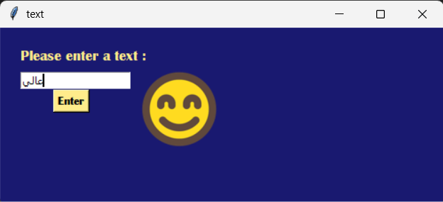

# Digikala Review Suggestion Prediction

## Project Overview

This project is a simple machine learning application that predicts the `Suggestion` label for a Persian text entered by the user. It uses the Digikala sentiment-analysis dataset, a TF-IDF text vectorizer, and a Linear Support Vector Classifier (LinearSVC).

The project also includes a desktop graphical user interface (GUI) built with Tkinter. The user enters a text and clicks **Enter**. The trained model predicts a label, and the application displays the corresponding image.

> **Important:** The model predicts the `Suggestion` column in the dataset. Do not interpret the labels as positive, neutral, or negative sentiment unless the dataset's label definitions confirm that meaning.

## Features

- Loads the dataset from Hugging Face.
- Saves the training and test splits as CSV files.
- Converts text into numerical TF-IDF features.
- Trains a `LinearSVC` classification model.
- Accepts text through a Tkinter input field.
- Displays an image associated with the predicted label.

## Dataset

The project uses the Hugging Face dataset:

- **Dataset:** [`ParsiAI/digikala-sentiment-analysis`](https://huggingface.co/datasets/ParsiAI/digikala-sentiment-analysis)
- **Text column:** `Text`
- **Target column:** `Suggestion`

The code exports the dataset splits to:

- `Dgkala_train.csv`
- `Dgkala_test.csv`

The model is trained using the `Text` and `Suggestion` columns from `Dgkala_train.csv`.

## Technologies and Libraries

- **Python** — programming language
- **Pandas** — loading and handling tabular data
- **Hugging Face Datasets** — downloading the dataset
- **scikit-learn** — TF-IDF feature extraction and LinearSVC classification
- **Tkinter** — desktop GUI
- **Pillow (PIL)** — loading, resizing, and displaying images

## How It Works

1. Download the dataset with `load_dataset()`.
2. Export the training and test splits to CSV files.
3. Read `Dgkala_train.csv` with Pandas.
4. Select `Text` as the input feature and `Suggestion` as the target label.
5. Use `TfidfVectorizer` to learn the vocabulary and transform training text into TF-IDF features.
6. Train a `LinearSVC` model on the transformed text and target labels.
7. Open the Tkinter window and enter a text.
8. Transform the entered text using the **same fitted TF-IDF vectorizer**.
9. Predict the label with the trained model.
10. Display the image associated with the predicted label.

## Project Structure

After running the program, the project folder should contain files similar to these:

```text
project/
├── main.py
├── Dgkala_train.csv
├── Dgkala_test.csv
├── 1.ico
├── 2.ico
├── 3.ico
└── README.md
```

- `main.py` — Python application (your Python script may have a different filename).
- `Dgkala_train.csv` — exported training split.
- `Dgkala_test.csv` — exported test split.
- `1.ico`, `2.ico`, `3.ico` — images displayed for the corresponding predicted labels.
- `README.md` — project documentation.

The CSV files are generated by the program, so they may not need to be included in version control if you prefer to generate them when the application runs.

## Installation

### 1. Install Python

Install a compatible version of Python from the [official Python website](https://www.python.org/downloads/).

### 2. Install the required libraries

Open a terminal in the project folder and run:

```bash
pip install datasets pandas scikit-learn pillow
```

Tkinter is included with many standard Python installations. On some Linux distributions, it may need to be installed separately through the operating system's package manager.

### 3. Run the application

Save the Python code in a file such as `main.py`, make sure the three image files are in the expected location, and run:

```bash
python main.py
```

The first run downloads the dataset and trains the model, so it may take some time and requires an internet connection. Later runs will still download the dataset if the code continues to call `load_dataset()` each time.

## How to Use

1. Start the application.
2. Type a Persian review or other text into the input field.
3. Click **Enter**.
4. The model predicts a `Suggestion` label.
5. The application displays the image associated with that label, provided that the predicted label matches one of the labels handled by the code and the image file can be opened.

## Model Details

### TF-IDF

`TfidfVectorizer` converts text into numerical features based on term frequency and inverse document frequency. This representation allows a machine learning model to process text.

```python
tf = TfidfVectorizer()
xx = tf.fit_transform(x)
```

The vectorizer must be fitted on the training text. For new text, use `transform()` rather than fitting the vectorizer again:

```python
features = tf.transform([entry])
```

### LinearSVC

`LinearSVC` is a linear Support Vector Classification model. It learns to predict the target labels from the TF-IDF features.

```python
model = LinearSVC()
model.fit(xx, y)
```

For a single user-entered text:

```python
p = model.predict(tf.transform([entry]))[0]
```

## Important Notes and Possible Improvements

- **Connect the button to the prediction function:** The Tkinter button should include `command=pre`; otherwise, clicking it will not call the function.
- **Pass text as a list:** Use `tf.transform([entry])`, not `tf.transform(entry)`.
- **Handle labels correctly:** Check `data["Suggestion"].unique()` to confirm the actual label values. If labels are strings, compare them with strings rather than integers.
- **Check image paths:** The `.ico` files must exist at the paths used by the program. You can use PNG files if you update the image paths accordingly.
- **Keep a reference to the image:** Store the `PhotoImage` on the label (for example, `label.image = img`) so Tkinter does not lose the image reference.
- **Handle empty input:** Consider checking whether the entry is empty before predicting.
- **Use the test split for evaluation:** The current code creates `Dgkala_test.csv` but does not evaluate the model on it. Accuracy, precision, recall, F1-score, and a confusion matrix can be added to measure performance.
- **Avoid data leakage:** Fit the TF-IDF vectorizer only on training text. Transform test text using the already-fitted vectorizer.
- **Check class-label meaning:** Confirm the dataset documentation before assigning a sentiment meaning to any numeric label.
- **Improve startup time:** Download and train the model once, then save the trained model and vectorizer for later use if appropriate.

## Limitations

- Prediction quality depends on the dataset, label quality, and training process.
- The project does not currently report evaluation metrics.
- The GUI only displays images for labels explicitly handled in the code.
- A prediction is a model output, not a guarantee that the text has been interpreted correctly.


## Software Output

The following image shows the software output and model results:



## Possible Future Improvements

- Evaluate the model on the test dataset.
- Display the predicted label as text as well as an image.
- Add a message for empty input or unsupported labels.
- Add a progress indicator while the dataset is downloaded and the model is trained.
- Save and load the trained model and TF-IDF vectorizer to reduce startup time.
- Improve the GUI layout and add a clear/reset button.

## Acknowledgements

- Dataset: [ParsiAI — Digikala Sentiment Analysis](https://huggingface.co/datasets/ParsiAI/digikala-sentiment-analysis)
- Machine learning tools: [scikit-learn](https://scikit-learn.org/)
- Dataset loading library: [Hugging Face Datasets](https://huggingface.co/docs/datasets)

## License

Check the dataset's license and terms on its Hugging Face page before redistributing the dataset or using it in a public or commercial project. Add a license for your own code if you intend to share it.
